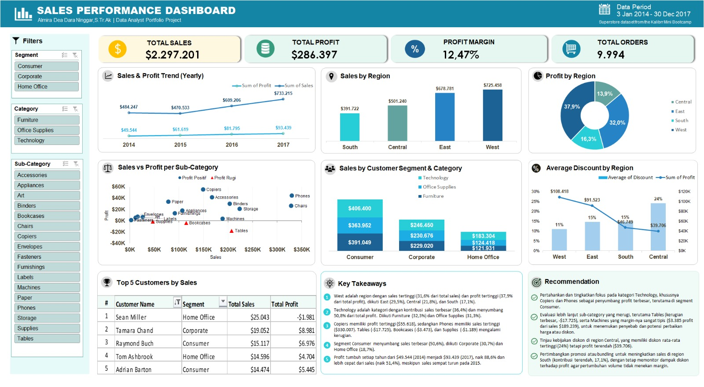

# Excel Sales Performance Dashboard

Dashboard interaktif untuk menganalisis performa penjualan dan profitabilitas, dibuat dengan Microsoft Excel (PivotTable, PivotChart, Slicer) menggunakan dataset Superstore dari Mini Bootcamp Kalibrr.

## Dataset

- **Sumber:** Superstore dataset (Mini Bootcamp Kalibrr)
- **Periode:** 3 Januari 2014 - 30 Desember 2017
- **Ukuran data:** 9.994 baris transaksi

## Key Metrics

| Metrik | Nilai |
|---|---|
| Total Sales | $2,297,201 |
| Total Profit | $286,397 |
| Profit Margin | 12.47% |
| Total Orders | 9,994 (baris transaksi) |

## Key Insights

1. **Profit tumbuh lebih cepat dari sales.** Profit naik 89% (2014-2017: $49,544 menjadi $93,439), sedangkan sales naik 51% ($484,247 menjadi $733,215). Sales sempat turun pada 2015.
2. **West unggul di sales dan profit.** West menyumbang 31.6% sales dan 37.9% profit.
3. **Consumer adalah segmen terbesar** dengan 50.6% dari total sales, diikuti Corporate (30.7%) dan Home Office (18.7%).
4. **Technology menyumbang 36.4% sales dan sekitar 50.8% profit.** Copiers memiliki profit tertinggi ($55,618), sedangkan Phones memiliki sales tertinggi ($330,007).
5. **Tiga sub-category merugi:** Tables (-$17,725), Bookcases (-$3,473), dan Supplies (-$1,189). Machines memiliki sales tinggi ($189,239) tetapi profit sangat tipis ($3,385).
6. **Central memiliki diskon rata-rata tertinggi (24%) tetapi profit terendah ($39,706)**, yang menunjukkan diskon besar menekan profit.

## Rekomendasi

- Pertahankan fokus pada kategori Technology, terutama Copiers dan Phones.
- Evaluasi sub-category yang merugi (terutama Tables) dan Machines yang margin-nya tipis, untuk menemukan penyebab dan potensi perbaikan harga atau diskon.
- Tinjau kebijakan diskon di region Central.
- Pertimbangkan promosi atau bundling di region South (kontribusi sales terendah, 17.1%) sambil memonitor dampak diskon terhadap profit.

## Fitur Dashboard

- KPI: Total Sales, Total Profit, Profit Margin, Total Orders
- Slicer interaktif: Segment, Category, Sub-Category
- Tren Sales dan Profit tahunan
- Sales dan Profit berdasarkan Region
- Sales berdasarkan Customer Segment dan Category
- Scatter plot Sales vs Profit per Sub-Category (titik merah = merugi)
- Rata-rata diskon vs Profit per Region
- Top 5 Customers
- Key Takeaways dan Recommendation

## Tools

- Microsoft Excel: PivotTable, PivotChart, Slicer, GETPIVOTDATA, scatter chart

## Skills Demonstrated

- Merangkum dan menganalisis data penjualan dengan PivotTable
- Membangun dashboard interaktif dengan KPI dan slicer
- Mengidentifikasi insight dan menyusun rekomendasi bisnis dari data

## Files

- [Excel-Sales-Performance-Dashboard.xlsx](Excel-Sales-Performance-Dashboard.xlsx)
- [dashboard.jpeg](dashboard.jpeg)
